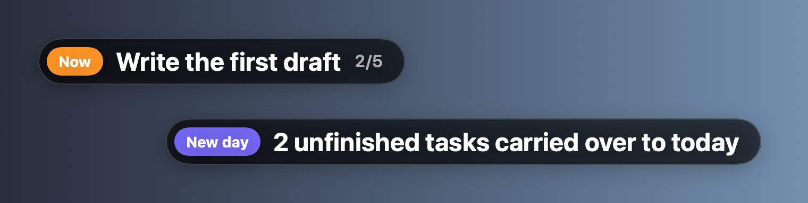
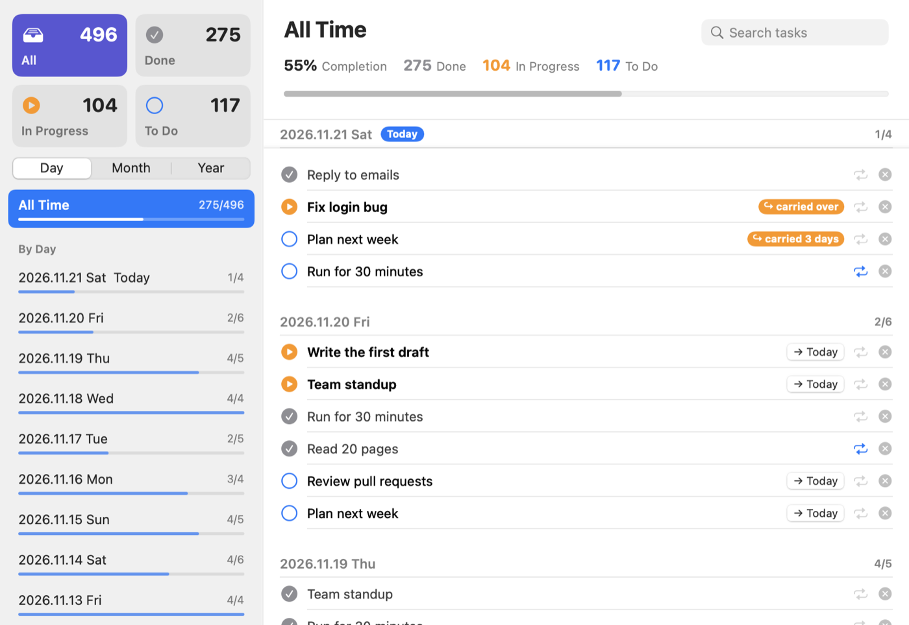

# FloatPlan

**A daily planner that floats over your Mac screen like on-screen comments.** Translucent, click-through, color-coded by progress. It starts a fresh list every day and reminds you what to work on with a banner that drifts across the screen.

[中文说明](README.zh-CN.md) · [Download](https://github.com/hychen11/FloatPlan/releases/latest)


## Why

Most floating sticky notes and to-do apps are just **regular always-on-top windows**. They cover what's underneath, you click them by accident, and they only know "done" or "not done", so you can't tell at a glance what you should be doing right now.

FloatPlan keeps today's plan in view but **out of your way**: your mouse clicks go straight through it to the window below, and one look tells you what's done, what's in progress, and what's left.

## Features

- **Three states, easy to read**
  - ✓ Done: gray, struck through
  - ▶ In progress: bold black
  - ○ To do: blue
- **One list per day.** The header shows the date (e.g. `2026.11.20 Fri · 2/5`), and a new list starts automatically when the day changes:
  - Unfinished tasks (to do or in progress) carry over to the new day with an orange **↪ carried over** tag; finished ones stay in history. Click the tag in edit mode to make it a regular to-do for today.
  - Tasks marked 🔁 **repeat daily** (exercise, reading…) come back every day, reset to to-do.
  - Choose when a new day starts (midnight or 3–6 AM), so the list doesn't flip while you're still up.
- **Plan History window**, Reminders-style: filter by Done / In Progress / To Do, browse by day, month or year, search, and edit any past day. Send an unfinished task from a past day to today with **→ Today**. For a quick look, hover over **Last 14 Days** in the menu bar.
- **Click-through.** The overlay never blocks your clicks.
- **Visible everywhere.** It shows on every desktop (Space) and over full-screen apps.
- **Edit with a shortcut.** Press `⌥⌘P` to edit, press it again to go back to click-through mode.
- **Opacity sliders.** Adjust the background and the text separately, with a live preview.
- **English and Chinese.** Follows your system language on first launch; switch any time from the menu bar.
- **Reminders.** Every 15, 30 or 60 minutes, the current task drifts across the screen in large text, together with a system notification.





## Install

1. Download `FloatPlan.zip` from [Releases](https://github.com/hychen11/FloatPlan/releases/latest), unzip it, and drag `FloatPlan.app` into Applications. No building required.
2. **The first launch is blocked by macOS** because the app isn't signed with a paid Apple developer certificate. Allow it either way:
   - Open **System Settings → Privacy & Security**, scroll down to FloatPlan, and click **Open Anyway**.
   - Or run this in Terminal:
     ```bash
     xattr -dr com.apple.quarantine /Applications/FloatPlan.app
     ```
3. The overlay appears in the top-right corner of your screen, and a ☑ icon appears in the menu bar.

Requires macOS 13 or later. Runs natively on Apple silicon and Intel.

## Usage

| What | How |
|---|---|
| Enter / leave edit mode | `⌥⌘P`, or menu bar ☑ → Edit Tasks |
| Change a task's state | In edit mode, click the icon on the left: to do → in progress → done |
| Repeat a task daily | In edit mode, click 🔁 on the right of the task |
| Add a task | In edit mode, type in the last row and press Return |
| Reorder / delete | In edit mode, click ↑ ↓ ✕ |
| Move the overlay | In edit mode, drag the top row |
| Adjust opacity | Menu bar ☑ → Background / Text sliders |
| Reminders | Menu bar ☑ → Reminders |
| When a new day starts | Menu bar ☑ → New Day Starts At |
| Past days | Menu bar ☑ → Plan History… (`⌘Y` while the menu is open), or hover Last 14 Days |
| Bring back an old task | Plan History → **→ Today** next to it, or right-click → Add to Today |
| Accept a carried-over task | Edit mode → click the orange **↪ carried over** tag |
| Language | Menu bar ☑ → 语言 / Language → 中文 or English |

> On a MacBook with a notch, the ☑ icon can end up hidden behind the notch when the menu bar is crowded. `⌥⌘P` works either way.

Your data stays on your Mac in `~/Library/Application Support/FloatPlan/plans.json`. FloatPlan has no network features and collects no data. When you upgrade from v0.1, your existing list becomes today's plan.

## Build from source

Only for changing the code. You don't need Xcode, just the command line tools:

```bash
xcode-select --install
```

```bash
git clone https://github.com/hychen11/FloatPlan.git
```

```bash
cd FloatPlan && ./build.sh && open build/FloatPlan.app
```

`./build.sh universal` builds for both Apple silicon and Intel.

## Roadmap

- [x] Daily plans and repeating tasks
- [x] English interface
- [ ] Multiple lists
- [ ] Custom colors and font size
- [ ] Launch at login

Issues and pull requests are welcome. If you like FloatPlan, a ⭐ helps others find it.

## License

[MIT](LICENSE)
