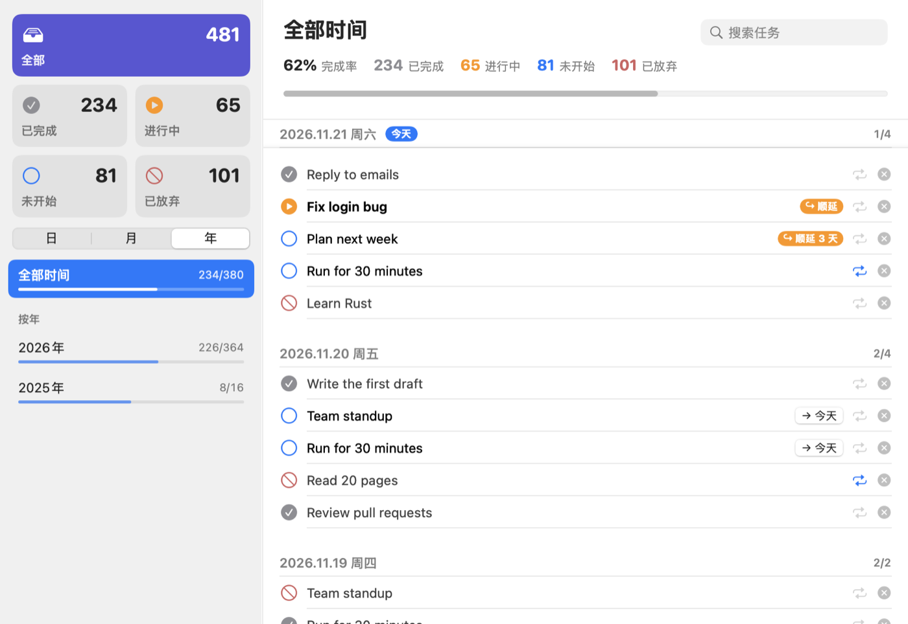

# FloatPlan

**像弹幕一样浮在屏幕上的 Mac 每日计划。** 半透明、不挡鼠标、按完成情况自动配色，每天自动换新清单，定时用弹幕提醒你该做什么。

[English](README.md) · [下载](https://github.com/hychen11/FloatPlan/releases/latest)


## 为什么做这个

市面上的悬浮便签/待办，大多是一个**普通的置顶窗口**：会挡住下面的内容，一不小心就点到；而且只分“完成 / 没完成”，看不出现在该做哪件。

FloatPlan 想要的是：今天的计划一直在视线里，但**像弹幕一样点不到、不打扰**，一眼就能看出“做完了什么、正在做什么、还剩什么”。

## 功能

- **四种状态，一眼看清**
  - ✓ 已完成：灰色 + 删除线
  - ▶ 进行中：黑色加粗
  - ○ 未开始：蓝色
  - ⊘ 已放弃：暗红色 + 删除线。只能从右键菜单设置，不会误点；不计入进度，也不会顺延
- **按天的计划**：顶部显示日期（如 `2026.11.20 周五 · 2/5`），过了一天自动换成新清单
  - 昨天**没完成**的任务（未开始、进行中）顺延到今天，并带橙色 **↪ 顺延** 标签提醒；完成的留在历史里。编辑模式下点标签，就变成今天的普通待办
  - 标记为 🔁 **每日重复** 的任务（跑步、读书……）每天自动出现，状态重置
  - 可设置“新的一天从几点开始”，熬夜时清单不会在零点突然换掉
- **历史计划窗口**，类似「提醒事项」：按已完成 / 进行中 / 未开始筛选，按日 / 月 / 年浏览，可搜索，过去任何一天都能直接编辑；过去没做完的任务点 **→ 今天** 加到今天。想快速看一眼，菜单栏悬停「最近 14 天」即可
- **点穿，不误触**：鼠标直接穿过悬浮层，点到下面的窗口
- **所有桌面都在**：切换桌面空间、全屏 App 里也能看到
- **快捷键编辑**：`⌥⌘P` 切换编辑模式，改完再按一次回到点穿状态
- **透明度滑块**：背景浓度、文字浓度分别调，拖动时实时预览
- **中文 / 英文界面**：第一次打开跟随系统语言，之后可在菜单栏随时切换
- **弹幕提醒**：每 15 / 30 / 60 分钟，一条带当前任务和今日进度的弹幕从屏幕飘过，同时发系统通知；新的一天开始时也会用弹幕告诉你顺延了几项




## 安装

1. 到 [Releases](https://github.com/hychen11/FloatPlan/releases/latest) 下载 `FloatPlan.zip`，解压后把 `FloatPlan.app` 拖进「应用程序」。
2. **第一次打开**会被系统拦下（因为没有付费开发者签名），任选一种方法放行：
   - 打开「系统设置 → 隐私与安全性」，在下方找到 FloatPlan，点「仍要打开」。
   - 或在终端运行：
     ```bash
     xattr -dr com.apple.quarantine /Applications/FloatPlan.app
     ```
3. 打开后悬浮层出现在屏幕右上角，菜单栏多一个 ☑ 图标。

要求 macOS 13 或更高，支持 Apple 芯片和 Intel。

## 使用

| 操作 | 方法 |
|---|---|
| 进入 / 退出编辑 | `⌥⌘P`，或菜单栏 ☑ → 编辑任务 |
| 切换状态 | 编辑模式下点任务左侧图标：未开始 → 进行中 → 已完成 |
| 放弃任务 | 编辑模式或历史计划里，右键任务 → 放弃 |
| 设为每日重复 | 编辑模式下点任务右侧的 🔁 |
| 添加任务 | 编辑模式最后一行输入，回车 |
| 调顺序 / 删除 | 编辑模式下点 ↑ ↓ ✕ |
| 移动位置 | 编辑模式下拖动顶部那一行 |
| 调透明度 | 菜单栏 ☑ → 背景浓度 / 文字浓度滑块 |
| 定时提醒 | 菜单栏 ☑ → 定时提醒 |
| 一天从几点开始 | 菜单栏 ☑ → 新的一天开始于 |
| 看以前的计划 | 菜单栏 ☑ → 历史计划…（菜单打开时按 `⌘Y`），或悬停「最近 14 天」 |
| 把以前的任务拿回今天 | 历史计划里点任务旁的 **→ 今天**，或右键 → 加到今天 |
| 接受顺延的任务 | 编辑模式下点橙色 **↪ 顺延** 标签 |
| 切换语言 | 菜单栏 ☑ → 语言 / Language → 中文 或 English |

> 刘海屏 MacBook 上，如果菜单栏图标太多，☑ 可能被刘海挡住，用 `⌥⌘P` 也一样。

数据保存在 `~/Library/Application Support/FloatPlan/plans.json`，纯本地，不联网、不收集任何数据。从 v0.1 升级时，原来的清单会自动变成当天的计划。

## 从源码编译

不需要 Xcode，只要命令行工具：

```bash
xcode-select --install
```

```bash
git clone https://github.com/hychen11/FloatPlan.git
```

```bash
cd FloatPlan && ./build.sh && open build/FloatPlan.app
```

`./build.sh universal` 会同时编译 Apple 芯片和 Intel 版本。

## 计划

- [x] 按天的计划 + 每日重复任务
- [x] 英文界面
- [x] 历史计划窗口、顺延提醒、放弃状态
- [ ] 多份清单切换
- [ ] 自定义颜色和字号
- [ ] 开机自动启动
- [ ] 上架 Mac App Store

欢迎提 [Issue](https://github.com/hychen11/FloatPlan/issues) 和 PR，觉得好用的话点个 ⭐ Star。

## 许可证

[MIT](LICENSE)
